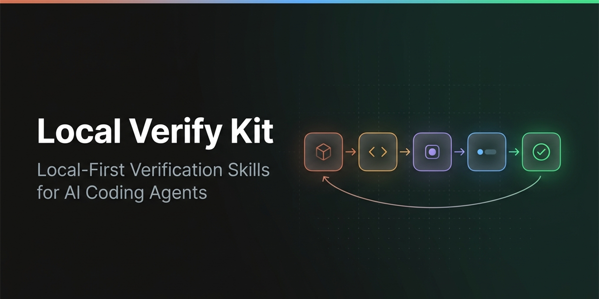
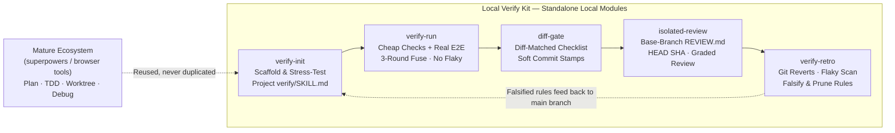

<p align="center">
  
</p>

<p align="center">
  <strong>Modular, local-first verification skills &amp; cross-agent delegation for AI coding agents.</strong><br />
  Run real E2E smoke checks, diff-triggered reliability audits, base-branch isolated code reviews, and git-history retrospectives — locally, with zero API keys and zero hard-implanted hooks.
</p>

<p align="center">
  <a href="./README.zh-CN.md">简体中文</a> ·
  <a href="#quick-start">Quick Start</a> ·
  <a href="#modular-skills">Modules</a> ·
  <a href="#cross-agent-delegation">Cross-Agent Delegation</a> ·
  <a href="#mid-flight-project-adoption">Existing Repos</a> ·
  <a href="./docs/GITHUB_SEO.md">Publishing Guide</a>
</p>

<p align="center">
  <a href="https://github.com/YIOYIOIOI/local-verify-kit/actions/workflows/ci.yml"></a>
  
  
  
  
</p>

---

## Why Local Verify Kit?

When AI coding agents write the majority of your code, **generation is no longer the bottleneck — verification is.**

Most agent verification setups fall into one of two traps:
1. **Over-coupled monolithic frameworks** that force an all-or-nothing state machine and fight with tools you already love (like `superpowers` or `chrome-devtools`).
2. **Cloud-only review gates** that require separate API keys, paid CI review SaaS, or fragile harness-specific hooks.

**Local Verify Kit** takes a different approach:
- **Strictly modular**: 5 standalone skills (plus 1 thin optional router). Use a single module or combine them — nothing forces a rigid pipeline.
- **Brings cloud guardrails down to local**: Base-branch `REVIEW.md` isolation (`git show main:REVIEW.md`), `HEAD` SHA binding, and git-history rule retrospectives run 100% locally with **zero API keys**.
- **Safe `subagent`-first delegation**: Independent verification, diff audits, and reviews default to the host's native isolated **`subagent`** (zero surprise external CLI quota burn). External CLIs (**Codex**, **Claude**) remain supported as strict explicit opt-in via a fail-closed `scripts/delegate.mjs` gate.
- **Zero hard-implanted hooks**: No fragile `PreToolUse` hook injection or harness lock-in. Verification readiness and commit stamps work via lightweight skill reminders and a standalone CLI script.
- **Reuse first, never duplicate**: Explicitly complements mature skills like [`obra/superpowers`](https://github.com/obra/superpowers) (planning, TDD, debugging, worktrees) and browser tools (`chrome-devtools`, Playwright, `browser-use`) instead of rewriting them.

---

## Architecture Overview



> Every box above works **independently**. Missing `.verify/` files never crash any skill — they degrade gracefully so you can drop any single skill into an existing repository today.

---

## Modular Skills

| Skill | Standalone Purpose | Brings Cloud Guardrail Locally | Default Executor (External CLI Opt-In) |
| :--- | :--- | :--- | :--- |
| **[`verify-init`](./skills/verify-init/SKILL.md)** | Inspect repo (Surface / Run / Drive / Observe), generate and live stress-test a project-local `verify/SKILL.md` | Non-destructive onboarding for new & mid-flight repos | Current agent (`self`, default) |
| **[`verify-run`](./skills/verify-run/SKILL.md)** | Run local fast checks + real end-to-end smoke verification, enforce a **3-round failure fuse**, reject `.skip`/`sleep` workarounds, write `.verify/last-run.json` | Objective runtime proof before pushing to CI | Clean isolated **`subagent`** (or `self`) |
| **[`diff-gate`](./skills/diff-gate/SKILL.md)** | Evaluate **only** the reliability checklist items whose trigger matches the current `git diff`; audit verification stamps via skill reminders | Targeted outage prevention without prompt bloat | Clean isolated **`subagent`** (read-only) |
| **[`isolated-review`](./skills/isolated-review/SKILL.md)** | Physically read `REVIEW.md` **only from the default branch** (`git show main:REVIEW.md`), detect rule tampering, bind to exact `HEAD` SHA, build progressively across rounds, classify `[Important]` / `[Nit]` / `[Pre-existing]` | Pulls cloud PR review isolation locally (zero API key) + optional `gh pr comment` | Clean isolated **`subagent`** (external `codex`/`claude` opt-in only) |
| **[`verify-retro`](./skills/verify-retro/SKILL.md)** | Scan recent `git log` reverts/hotfixes, hunt `.skip`/`sleep` shortcuts in test files, audit rule file bloat, falsify candidate rules with a skeptic agent before human sign-off | Pulls post-merge evaluation & rule pruning locally | Local scanner + isolated **`subagent`** skeptic |
| **[`verify-flow`](./skills/verify-flow/SKILL.md)** | Ultra-thin, non-mandatory menu that routes to existing mature skills first and lets you pick one standalone module | Keeps workflows unbundled | Defaults to **`subagent`** |

---

## Quick Start

Because `local-verify-kit` follows the open **Agent Skills standard** with zero harness-specific lock-in, it installs cleanly across modern AI coding agents.

### Option 1: Install via `npx skills` (Universal — Claude Code, Codex, Cursor, Windsurf, etc.)
```bash
# Install all modular skills
npx skills add YIOYIOIOI/local-verify-kit

# Or install just ONE standalone skill (every skill works independently!)
npx skills add YIOYIOIOI/local-verify-kit --skill isolated-review
```

### Option 2: Install as a Plugin
- **Claude Code**:
  ```bash
  claude --plugin-dir /path/to/local-verify-kit
  # Or register via marketplace once published on GitHub
  ```
- **Antigravity / Open Plugin Hosts**:
  Clone into your global plugins folder (`~/.gemini/config/plugins/local-verify-kit`) or project `.agents/plugins/local-verify-kit`.
- **OpenAI Codex / Repo-Local Shared Skills**:
  Copy any individual folder from `skills/` into `.agents/skills/` or `~/.agents/skills/`.

---

## Install Globally, Activate Per-Project (`off` / `lite` / `full`)

You do **not** need to install skills separately into every repository — install `local-verify-kit` **globally once**, and control how heavy or light verification feels per project via an optional `.verify/config.json`:

| Profile | Setup in Repo | Active by Default | Best For |
| :--- | :--- | :--- | :--- |
| **`off` (Default)** | **Nothing** (no `.verify/` folder) | None automatically — zero noise; explicit invocation always works | Simple scripts, prototypes, small utilities |
| **`lite`** | `{ "profile": "lite" }` ([example](./examples/config.lite.json)) | `verify-run` only (fast checks + E2E smoke + 3-round fuse) | Small/medium personal tools (skips heavy pre-PR review ceremony) |
| **`full`** | `{ "profile": "full", ... }` ([example](./examples/config.json)) | `verify-run`, `diff-gate`, `isolated-review`, `verify-retro` | Core production & multi-contributor repositories |
| **Custom `modules`** | `{ "profile": "lite", "modules": ["verify-run", "isolated-review"] }` | Exact subset you list | Tailored workflows |
| **Dual-Repo / Multi-Target `targets`** | `{ "profile": "lite", "targets": { "private": { "profile": "lite" }, "public": { "profile": "full" } } }` ([example](./examples/config.dual-repo.json)) | Resolves active profile per push/PR target (`--target public`) | Private daily iteration + strict public sync/release |

**Explicit user instructions always override the profile**:
- On a zero-config simple repo, say *"Run `isolated-review` with codex on this change"* → runs once on demand without creating `.verify/`.
- On a `full` repo, say *"Docs typo only, skip verification"* → skips immediately.

*(Optional harness-level strictness: if you want to block implicit invocation completely at the host level, Claude Code supports `disable-model-invocation: true` in skill frontmatter and Codex supports `allow_implicit_invocation: false` in `agents/openai.yaml`.)*

---

## Cross-Agent Delegation (Default: `subagent`, External CLIs Fail-Closed)

Writing code and reviewing/verifying it in the exact same conversation creates confirmation bias. Every execution skill defaults to a **clean isolated `subagent`** in your current host so you get independent verification with **zero surprise external CLI quota consumption**:

1. **Default (`subagent`)**: `verify-run`, `diff-gate`, `isolated-review`, and `verify-retro` run in a fresh host-native subagent (`self` fallback only if the host has no subagent support).
2. **External CLIs (`codex` / `claude`) — strict explicit opt-in**:
   - `scripts/delegate.mjs` is **fail-closed by default** (exits with code `3` and points back to `subagent`).
   - Agents must never auto-select external CLIs, persist them into `.verify/config.json` unasked, or silently fall back from one external CLI to another when one fails.
   - Only when you explicitly want external CLI delegation, opt in via either `LOCAL_VERIFY_ALLOW_EXTERNAL_CLI=codex` (or `none` as a global kill-switch) or `"allowExternalCli": ["codex"]` in `.verify/config.json`.
3. Recommended starter `.verify/config.json` (see [`examples/config.json`](./examples/config.json)):

```json
{
  "profile": "full",
  "baseBranch": "main",
  "delegation": {
    "verify-init": "self",
    "verify-run": "subagent",
    "diff-gate": "subagent",
    "isolated-review": "subagent",
    "verify-retro": "subagent"
  },
  "commitCheck": {
    "mode": "observe",
    "requireAny": ["verify-run", "isolated-review"],
    "maxAgeMinutes": 120,
    "maxBlocksPerSession": 2
  }
}
```

Check local CLIs and active external-CLI policy anytime:
```bash
node scripts/delegate.mjs --check --cwd <repo>
```

---

## Mid-Flight Project Adoption

Already halfway through an existing repository? **No rewrite or upfront init required:**

1. **Use any skill immediately**: `verify-run`, `diff-gate`, `isolated-review`, and `verify-retro` all degrade gracefully when `.verify/` or `REVIEW.md` does not exist yet.
2. **Start with `verify-retro` on existing repos**: Mining your existing `git log` (past reverts, bugfixes, and `.skip`/`sleep` tests) gives you high-signal rules grounded in real incidents instead of guesswork.
3. **Run `verify-init` incrementally**: Generates and live stress-tests your project's `verify/SKILL.md` without overwriting existing tests or CI.
4. **Merge `REVIEW.md` to `main` first**: Once your starter `REVIEW.md` lands on the default branch, `isolated-review` immediately enforces tamper-proof base-branch rule isolation on every feature branch.

---

## Why No Hard-Implanted Hooks?

Harness hook protocols (`PreToolUse`, `Bash` vs `run_command`, tool payload schemas) differ across AI coding tools and frequently break portability or annoy developers with false-positive blocks.

Instead, `local-verify-kit` uses:
- **Skill-level reminders** before commits to run `skills/diff-gate/scripts/commit-check.mjs` and append transparent `Verified-by:` commit trailers (including `Verified-by: none (<reason>)` when skipped).
- **Safe `observe` mode by default**, plus an explicit `[skip-verify: <reason>]` escape hatch and a 2-block session circuit breaker when `enforce` mode is opted into.
- **Optional standard Git `.git/hooks/pre-commit`**: Teams that *explicitly* want hard OS-level enforcement can invoke `node <path>/commit-check.mjs` from a standard Git hook — completely independent of whichever AI tool they use.

---

## Verification & Testing This Repository

This repository dogfoods its own zero-dependency discipline:

```bash
npm run check
```

Runs:
- `npm run lint:skills` — validates manifests, YAML frontmatter, zero-hook policy, and anti-host-lock-in hygiene.
- `npm test` — executes real temporary Git repository integration tests for rule-tampering isolation, flaky-test detection, commit readiness modes, and CLI delegation checks.

---

## Ecosystem Credits & Inspiration

Built to compose cleanly with — and inspired by — pioneering work across the AI engineering community:
- Anthropic's verification-loop engineering practices (E2E smoke harnesses, 3-round fuse, base-branch isolated `REVIEW.md`, diff-triggered checklists, falsified rule distillation, and routine pruning).
- [`obra/superpowers`](https://github.com/obra/superpowers) for TDD, planning, worktrees, debugging, and verification-before-completion discipline.
- [`backnotprop/pstack`](https://github.com/backnotprop/pstack) for the Surface / Run / Drive / Observe verification skill scaffolding pattern.
- [`EveryInc/compound-engineering-plugin`](https://github.com/EveryInc/compound-engineering-plugin) for compounding lessons back into repository knowledge.

## License

[MIT](./LICENSE)
