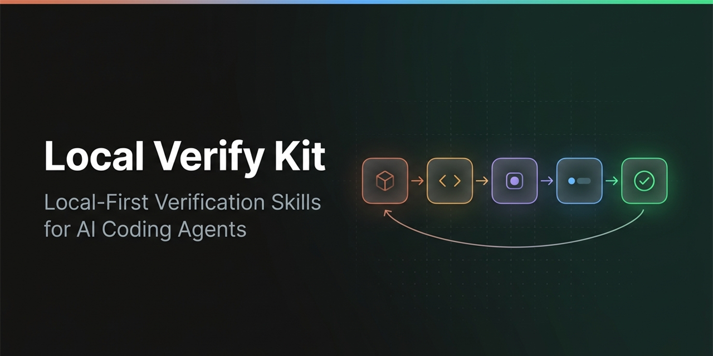
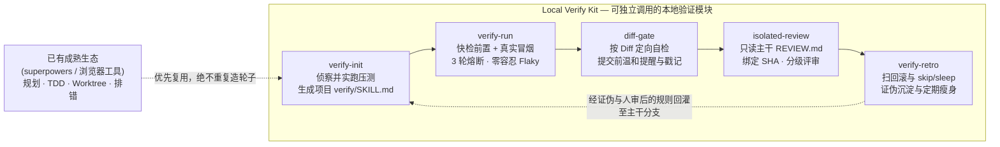

<p align="center">
  
</p>

<p align="center">
  <strong>面向 AI 编程 Agent 的模块化、本地优先验证技能套件与跨 Agent 委派方案。</strong><br />
  在本地零 API Key、零硬植入 Hook 跑通端到端冒烟测试、按 Diff 触发的可靠性自检、主干分支隔离代码评审与 Git 历史复盘。
</p>

<p align="center">
  <a href="./README.md">English</a> ·
  <a href="#快速开始">快速开始</a> ·
  <a href="#独立模块清单">模块清单</a> ·
  <a href="#跨-agent-委派机制">跨 Agent 委派</a> ·
  <a href="#老项目半路接入指南">半路接入</a> ·
  <a href="./docs/GITHUB_SEO.md">GitHub 发布与 SEO 指南</a>
</p>

<p align="center">
  <a href="https://github.com/YIOYIOIOI/local-verify-kit/actions/workflows/ci.yml"></a>
  
  
  
  
</p>

---

## 为什么做 Local Verify Kit？

当 AI 编程 Agent 承担了绝大多数代码编写工作后，研发的核心瓶颈不再是“写代码”，而是**“如何用客观证据验证代码真的没坏”**。

现有方案往往容易踩进两个坑：
1. **过度统一化的重型大框架**：强迫从头跑到尾，和你本机已有的成熟工具（如 `superpowers`、`chrome-devtools`）互相打架。
2. **强绑定云端或单一宿主 Hook**：需要额外购买按量 API Key、付费 PR Review 服务，或者硬塞各家不兼容的 `PreToolUse` Hook 导致频繁误拦、跨端难以移植。

**Local Verify Kit** 坚持五条克制的设计原则：
* **高度模块化、绝不过度统一**：5 个完全独立的 Skill（外加 1 个极薄可选路由）。需要哪个环节就只用哪个，拆出任意单个 Skill 也能独立工作。
* **把云端护栏完整拉回本地（零 API Key）**：主干分支隔离读取 `REVIEW.md`（`git show main:REVIEW.md`）、精确绑定 `HEAD` SHA、以及基于本地 Git 历史的漏报复盘与规则瘦身，全部纯本地跑通。
* **原生支持跨 Agent 委派**：每个执行 Skill 动手前都会确认是否指派给其他 Agent（例如当前 Agent 写代码，把 `verify-run` 或 `isolated-review` 委派给本地 **Codex**、**Claude** 或干净子代理），天然实现“裁判与选手分离”。
* **零硬植入 Hook**：不往任何宿主的 Hook 系统强行注入拦截器，改为在 Skill 中温和提醒并配合独立 CLI 脚本留痕，100% 通用跨端。
* **复用优先，不重复造轮子**：与 [`obra/superpowers`](https://github.com/obra/superpowers)（规划、TDD、Worktree、系统排错、分支收尾）及浏览器驱动工具（`chrome-devtools` / Playwright / `browser-use`）互补协作，只精准补齐验证缺口。

---

## 全景架构



> 以上每个方块都可以**单独启用**；即使仓库里没有 `.verify/` 目录也不会报错，全部平滑降级运行。

---

## 独立模块清单

| 独立 Skill | 核心职责 | 拉回本地的关键机制 | 常见跨 Agent 委派搭配 |
| :--- | :--- | :--- | :--- |
| **[`verify-init`](./skills/verify-init/SKILL.md)** | 侦察项目（Surface / Run / Drive / Observe），生成并**当场实跑压测**专属 `verify/SKILL.md` | 新老项目非破坏性增量接入 | 默认当前 Agent |
| **[`verify-run`](./skills/verify-run/SKILL.md)** | 先跑便宜快检，再真启动应用端到端冒烟，强制 **3 轮失败熔断叫人**，禁止 `.skip`/`sleep`，写 `.verify/last-run.json` | 推送前拿真实运行证据 | 常委派给 **`codex`** 或干净子代理 |
| **[`diff-gate`](./skills/diff-gate/SKILL.md)** | 仅评估本次 `git diff` 触发命中的历史可靠性清单；提交前温和提醒检查并附带验证戳记 | 精准防复发、不塞爆上下文 | 当前 Agent 或只读 `codex` / `claude` |
| **[`isolated-review`](./skills/isolated-review/SKILL.md)** | 物理强制只从默认主分支读取 `REVIEW.md`（防分支篡改规则），绑定精确 `HEAD` SHA，多轮递进，按 `[Important]` / `[Nit]` / `[Pre-existing]` 分级 | **云端隔离 PR 评审拉回本地**（零 API Key）+ 可选 `gh pr comment` | **强推荐异构交叉裁判**（`codex` ↔ `claude` / 当前宿主） |
| **[`verify-retro`](./skills/verify-retro/SKILL.md)** | 扫描近期 `git log` 回滚与热修、查测试里的 `.skip`/`sleep` 敷衍、统计规则膨胀度，派证伪官挑战候选规则后再交人审 | **云端评测与规则演化拉回本地** | 本地脚本扫描 + 独立证伪官（`codex` / `claude`） |
| **[`verify-flow`](./skills/verify-flow/SKILL.md)** | 极薄、非强制导航路由：优先路由至已有成熟 Skill，再按需选 1 个独立模块 | 绝不强绑流水线 | 透传你选定的执行者 |

---

## 快速开始

本套件严格遵循开放的 **Agent Skills 规范**，无宿主绑定，可在 Claude Code、Codex、Cursor、Antigravity 等任意支持 Skills 的工具中开箱使用。

### 方式 1：通过 `npx skills` 安装（通用多端）
```bash
# 安装全部模块
npx skills add YIOYIOIOI/local-verify-kit

# 或只装其中任意 1 个独立 Skill（每个都可独立运行）
npx skills add YIOYIOIOI/local-verify-kit --skill isolated-review
```

### 方式 2：作为 Plugin / 本地目录直接使用
* **Claude Code**：`claude --plugin-dir /path/to/local-verify-kit`（或发布后通过插件市场添加）
* **Antigravity / 支持开放 Plugin 的宿主**：放入 `~/.gemini/config/plugins/local-verify-kit` 或项目 `.agents/plugins/local-verify-kit`
* **OpenAI Codex / 仓库共享 Skill**：直接将 `skills/` 下任意子目录复制到 `.agents/skills/` 或 `~/.agents/skills/`

---

## 跨 Agent 委派机制

同一个对话里既写代码又当裁判，极易陷入思维惯性。本套件每个执行 Skill 开头都内置了**执行者路由确认**：

1. 默认配置为 `"ask"`，动手前会简短询问由谁执行：
   * 当前 Agent
   * 干净上下文独立子代理
   * 本地 **`codex`** CLI（评审与自检默认只读沙盒 `-s read-only`，冒烟验证使用 `-s workspace-write`）
   * 本地 **`claude`** CLI（非交互 `-p` 模式，评审默认限制为只读工具集）
2. 若想在某个仓库固化分工，可按需创建 `.verify/config.json`（参考 [`examples/config.json`](./examples/config.json)）：

```json
{
  "baseBranch": "main",
  "delegation": {
    "verify-init": "ask",
    "verify-run": "codex",
    "diff-gate": "ask",
    "isolated-review": "claude",
    "verify-retro": "ask"
  },
  "commitCheck": {
    "mode": "observe",
    "requireAny": ["verify-run", "isolated-review"],
    "maxAgeMinutes": 120,
    "maxBlocksPerSession": 2
  }
}
```

随时检查本机可用的外部 Agent CLI：
```bash
node scripts/delegate.mjs --check
```

---

## 老项目半路接入指南

项目已经写到一半才安装本插件？完全不需要推倒重来：
1. **零初始化即可单点使用**：`verify-run`、`diff-gate`、`isolated-review`、`verify-retro` 在没有 `.verify/` 和 `REVIEW.md` 时均自动平滑降级。
2. **推荐先跑一次 `verify-retro`**：直接从老项目已有的 `git log` 回滚/热修和 `.skip`/`sleep` 测试里挖出第一批高价值规则，比空想准确得多。
3. **再增量跑 `verify-init`**：在不覆盖现有测试和 CI 的前提下，补齐并当场压测 `verify/SKILL.md`。
4. **先把 `REVIEW.md` 合入 `main`**：只要主分支有了 `REVIEW.md`，后续所有功能分支跑 `isolated-review` 就能立刻获得防篡改隔离保护。

---

## 为什么取消 Hook 硬植入？

各家 AI 编程工具的 Hook 协议（事件名、工具名、stdin/stdout 契约）互不统一，硬植入 Hook 既破坏通用性，又容易在误报时打断正常开发。

本套件改为 **“Skill 温和提醒 + 独立 CLI 脚本”**：
* 在提交前通过 Skill 提醒运行 `skills/diff-gate/scripts/commit-check.mjs`，并在 commit message 末尾附带 `Verified-by:` 验证戳记（未验证也如实写 `Verified-by: none (<原因>)`）；
* 默认 `observe` 观察模式绝不拦人；即便主动切到 `enforce`，也支持 `[skip-verify: 原因]` 豁免及“同会话连拦 2 次后第 3 次放行”防死锁逃生阀；
* 如果团队后续确实需要系统级硬拦截，只需自己把 `commit-check.mjs` 挂到标准 `.git/hooks/pre-commit` 中即可，彻底独立于任何 AI 工具。

---

## 本地自测

本仓库自身零外部依赖，自带完整验证套件：

```bash
npm run check
```

包含：
* `npm run lint:skills`：校验所有清单 JSON、Skill frontmatter、零硬植入 Hook 原则与跨端纯净度（禁止宿主专有字段泄露）。
* `npm test`：使用真实临时 Git 仓库测试主干规则篡改拦截、历史回滚与 Flaky 扫描、提交准备度模式与逃生阀、以及外部 CLI 探测。

## 开源协议

[MIT](./LICENSE)
